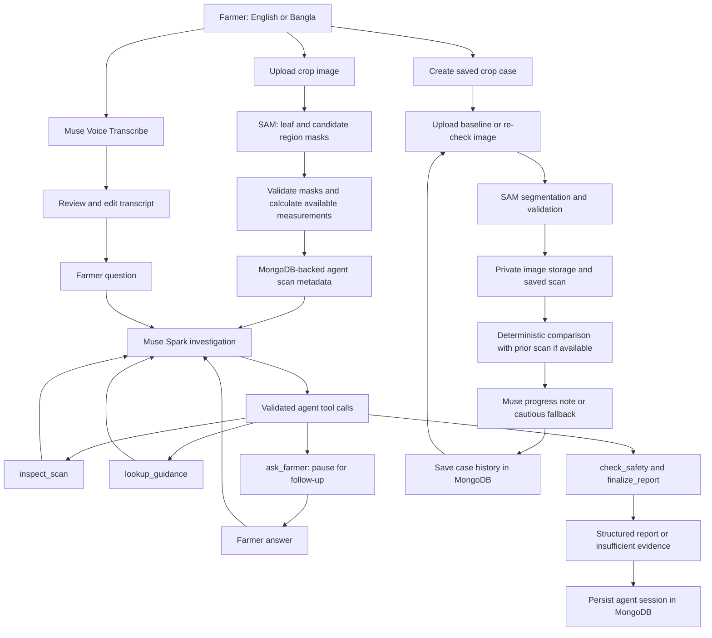

# 🌱 KrishiLens

### Smarter Farming Starts Here.

KrishiLens is an AI-powered crop-care investigation agent that helps farmers observe crop problems, investigate symptoms, ask follow-up questions, and monitor changes over time.

**Meta Global AI Developer Hackathon 2026 · Indie Developer Track · Build for Your World**

**[Live website](https://krishilens.fuadhasan.dev/)** · **[Watch the demo](https://www.youtube.com/watch?v=dPjz6FJ9dDs)** · **[GitHub](https://github.com/fuadhasandev/krishilens)**

   

## The problem

For smallholder farmers, especially in Bangladesh, a discolored leaf raises questions that a single image cannot settle. Symptoms can look alike, timely agricultural expertise can be difficult to reach, and language barriers make advice harder to use. Without a record of earlier observations, it is also difficult to tell whether a crop's visible condition has changed.

## The solution

KrishiLens supports an ongoing investigation: observe an image, describe the problem in English or Bangla, answer a contextual question, review a cautious report, and return to a saved crop case for another scan. It keeps visual measurements separate from agricultural interpretation and makes missing evidence explicit.

## Demo

[](https://www.youtube.com/watch?v=dPjz6FJ9dDs)

**[Watch the updated demo on YouTube](https://www.youtube.com/watch?v=dPjz6FJ9dDs)** · **[Open the live website](https://krishilens.fuadhasan.dev/)**

To try the application:

1. Open **[KrishiLens](https://krishilens.fuadhasan.dev/)** and select English or Bangla. First-time visitors default to English; the selection is saved in the browser.
2. Start image analysis and upload a JPEG, PNG, or WebP crop image, up to 4 MB.
3. Review the SAM overlay and measurement availability. Describe your concern by typing or recording a question; edit the transcript before submitting.
4. Start the agent investigation, answer any follow-up question, and review its observations, evidence limits, and safe next steps.
5. Open case history to create a crop case, upload a baseline through its re-check form, and return with another image for comparison.

The standalone image investigation and saved-case re-check workflow are separate paths today. Standalone investigations are not automatically attached to crop cases. Render cold starts and external model latency can delay responses.

## Key features

These features are implemented in the checked-in code; that does not mean every workflow has been verified against production services.

| Feature | What the application does |
| --- | --- |
| AI crop investigation | Runs a bounded Muse Spark tool-calling loop over validated scan observations and the farmer's question. |
| SAM 3.1 segmentation | Requests leaf and candidate affected-region masks, parses streamed results, and displays an overlay. SAM does not diagnose disease. |
| Candidate region measurement | Calculates the candidate-mask intersection with the leaf mask as a percentage of leaf pixels, only when validation permits it. |
| Contextual follow-up | Saves one focused question, pauses for the farmer, then resumes the investigation with the answer. |
| Agricultural evidence lookup | Searches a curated rice reference collection. Its current BRRI record supports institutional referral only; no symptom-specific agronomic passage is available. |
| English and Bangla | Provides bundled interface translations, language-aware requests, and explicit translation of agent reports/questions while preserving originals. |
| Muse Voice Transcribe | Records in the browser, converts audio to WAV, and transcribes English or Bengali through Meta's `muse-voice-transcribe-1.0`. Transcripts remain editable. |
| Persistent cases and sessions | Uses MongoDB-backed cases, scans, investigations, traces, re-checks, anonymous owners, and agent state. |
| Private case images | Persists saved case re-check images only: local private storage by default in development, or authenticated Cloudinary storage in production, delivered through owner-authorized API requests. Standalone analysis images are processed in memory and not retained. |
| Re-check and comparison | Saves subsequent scans, checks measurement and capture comparability, and reports percentage-point changes with cautious progress notes. |
| Responsible AI | Validates tools and reports, rejects unsupported claims, and preserves unavailable measurements and insufficient-evidence outcomes. |
| Re-check dates | Displays upcoming/overdue dates in the app; automatic notifications are a future improvement. |

Rice is the focus of the curated reference collection. The forms/API also accept wheat, maize, jute, and other crops; those choices do not establish validated multi-crop diagnostic coverage.

## Agentic workflow and architecture

The conceptual journey is **Farmer → Upload Image → SAM Segmentation → Validate Measurements → Muse Spark Investigation → Agent Tool Calls → Follow-up Questions → Evidence-Based Outcome → Save Case → Re-check**. The actual implementation has separate agent and case-persistence paths:



### Visual measurements, not diagnoses

The backend decodes, auto-rotates, and resizes uploaded images to at most 2048 × 2048 pixels while preserving aspect ratio. It sends a crop-specific leaf concept to SAM, tries the generic `leaf` concept if no match is found, and requests the selected candidate region separately when a leaf is detected.

```text
candidate affected-region percentage =
    pixels in (candidate mask ∩ leaf mask) / leaf-mask pixels × 100
```

Green outlines show the leaf; orange pixels show the candidate region, including any portion outside the leaf. Missing, invalid, disjoint, or unreliable masks can make the estimate unavailable or require review. An unavailable estimate must not become a zero-damage claim. This geometric measurement is neither a disease diagnosis nor validated disease severity.

### Agentic AI architecture

KrishiLens implements a **plan–act–observe loop** in [server/src/agent/loop.ts](server/src/agent/loop.ts). Muse Spark chooses permitted tool actions, receives validated outputs, and continues or pauses for farmer input. It uses Meta's Responses API function-calling protocol with matching `function_call_output` items and `previous_response_id`.

The [tool registry](server/src/agent/toolRegistry.ts) exposes these exact functions:

| Tool | Responsibility |
| --- | --- |
| `inspect_scan` | Read original validated scan observations without changing measurements. |
| `lookup_guidance` | Retrieve curated rice reference records and explicitly report missing relevant evidence. |
| `ask_farmer` | Save a contextual follow-up question and pause until an answer arrives. |
| `check_safety` | Check a proposed report against the original scan and retrieved evidence. |
| `finalize_report` | Validate and produce the structured investigation report. |

Execution is bounded to six model turns and eight tool calls per turn. The server validates tool names, input schemas, and output schemas, and blocks identical repeated calls without new farmer information. Sanitized traces show actions and evidence references rather than hidden model reasoning or farmer answers.

Reports include visible observations, tentative possible causes, missing information, safe next steps, citations, escalation recommendations, evidence status, and measurement quality. Backend checks reject un-retrieved citations, unsupported percentages, institutional sources used as disease evidence, and chemical treatment instructions. Original measurements and citations come from validated server data.

This agent can choose tools, pause for a human answer, resume a persistent session, and validate a structured outcome. Its saved-case workflow adds deterministic follow-up comparisons. Those behaviors go beyond a single predicted label or an unstructured chat reply. **The current evidence collection cannot support symptom-level disease conclusions:** a truthful insufficient-evidence result is an intended outcome.

## Models

| Model | Purpose | Integration status |
| --- | --- | --- |
| `muse-spark-1.3` | Tool-calling investigation, text-only crop questions, explicit report translation, and cautious re-check progress notes. | Implemented through the Meta Responses API using the OpenAI SDK transport; mocked automated coverage and an opt-in real-service E2E test. |
| `sam-3.1` | Segment leaf and candidate visual regions for backend mask validation and measurement. | Implemented with `@meta-sam/parser`; parser/mask/error tests and an opt-in real-service E2E test. |
| `muse-voice-transcribe-1.0` | Convert English/Bengali speech into editable question text. | Implemented through Meta's `/asr/transcribe`; mocked tests and an opt-in live test with consented fixtures. English or Bengali is selected from the chosen UI language. |

Voice supplies text; SAM supplies visual masks; Muse Spark investigates validated observations and farmer context through tools. The agent receives scan metadata rather than using SAM as a disease classifier. Implementation and test availability do not establish current production model success; see [Testing and verification](#testing-and-verification).

## Tech stack

Versions below are declared dependency ranges in the package manifests, not independently verified versions of deployed services.

| Layer | Technologies |
| --- | --- |
| Frontend | React `^19.3.1`, Vite `^8.3.5`, TypeScript `~7.0.2`, Tailwind CSS `^4.3.3`, react-i18next `^17.1.9`, i18next `^26.5.12`, React Router, Axios |
| Backend | Node.js `22.x`, Express `^5.1.0`, TypeScript `~5.9.3`, tsx, Zod, Multer, Sharp |
| AI | Meta Model API; OpenAI SDK `^6.49.0` as transport; `@meta-sam/parser` `^0.1.0`; Muse Spark, SAM, Muse Voice |
| Database | MongoDB Atlas / compatible local MongoDB, Mongoose `^9.11.4` |
| Image storage | Cloudinary SDK `^2.11.0`; authenticated delivery; private local development adapter |
| Hosting | Vercel frontend, Render API |
| Testing | Vitest `^4.1.12`, Testing Library, jsdom, Node test runner through tsx |

## Install and run locally

### Prerequisites

- **Node.js 22.x and npm**, as required by all three package manifests.
- A reachable MongoDB Atlas database or local MongoDB instance. The API connects before listening and fails startup if the database is unavailable.
- A server-side Meta Model API key for live model requests.
- Cloudinary credentials when using cloud image storage; local private storage is the development default.

```sh
git clone https://github.com/fuadhasandev/krishilens.git
cd krishilens
npm install
npm install --prefix client
npm install --prefix server
cp server/.env.example server/.env
cp client/.env.example client/.env
```

Edit the copied environment files locally. The server loads backend settings from `server/.env`; the root [.env.example](.env.example) is a reference template and is not loaded by the app. Keep credentials out of Git and out of browser variables.

| Variable | Location | Purpose / default |
| --- | --- | --- |
| `PORT` | Server | HTTP port; defaults to `3000`. |
| `CLIENT_URL` | Server | Exact allowed frontend origin; defaults to `http://localhost:5173`. |
| `MODEL_API_KEY` | Server | Meta credential required for real AI requests. |
| `META_BASE_URL` | Server | Defaults to `https://api.meta.ai/v1`. |
| `MONGODB_URI` | Server | Required MongoDB connection string; example uses local `krishilens` database. |
| `IMAGE_STORAGE_PROVIDER` | Server | `local` by default; production requires `cloudinary`. |
| `LOCAL_IMAGE_STORAGE_DIR` | Server | Development private images; defaults to `./data/private-images` from the server directory. |
| `CLOUDINARY_CLOUD_NAME` | Server | Required with Cloudinary storage. |
| `CLOUDINARY_API_KEY` | Server | Required with Cloudinary storage; server-only. |
| `CLOUDINARY_API_SECRET` | Server | Required with Cloudinary storage; server-only. |
| `VITE_API_URL` | Client | Public backend origin; local default is `http://localhost:3000`. Production builds require an HTTPS origin without `/api`. Never put secrets in `VITE_*`. |

Start both apps from the repository root:

```sh
npm run dev
```

Open <http://localhost:5173>. The API listens at <http://localhost:3000>; check <http://localhost:3000/api/health>.

### Commands

Run from the repository root:

| Command | Purpose |
| --- | --- |
| `npm run dev` | Start frontend and backend together. |
| `npm run dev --prefix client` | Start Vite only. |
| `npm run dev --prefix server` | Start the backend with tsx watch. |
| `npm test` | Run frontend tests, then backend tests. Live integration tests are opt-in. |
| `npm run test --prefix client` | Run frontend Vitest tests. |
| `npm run test --prefix server` | Run backend Node/tsx tests with local image storage. |
| `npm run lint --prefix client` | Run Oxlint. |
| `npm run typecheck --prefix server` | Check backend types without emitting files. |
| `npm run build --prefix server` | Compile backend and copy agent assets. |
| `npm start --prefix server` | Run compiled backend; build and configure it first. |
| `npm run preview --prefix client` | Preview an already built frontend locally. |

Root `typecheck` also builds the client. Supply a public HTTPS API origin for both root build commands:

```sh
VITE_API_URL=https://krishilens-api.onrender.com npm run typecheck
VITE_API_URL=https://krishilens-api.onrender.com npm run build
```

## API overview

All routes below are mounted under `/api`. Protected endpoints require an Authorization header containing the appropriate route token; never put tokens in URLs or logs. Scan, investigation-session, and anonymous-owner tokens are separate and are not interchangeable account credentials.

| Method and endpoint | Purpose | Access |
| --- | --- | --- |
| `GET /api/health` | API responsiveness. | No token. Does not test all external services. |
| `POST /api/ai/analyze` | Text-only crop question, separate from the tool-calling agent. | No token. |
| `POST /api/images/segment` | Upload image, segment, return measurements/overlay and `scanId` / `scanAccessToken`. | No token. |
| `POST /api/voice/transcribe` | Transcribe multipart `audio` with `language`. | No token without context; matching scan/session token required if `scanId` or `sessionId` is provided. |
| `POST /api/agent/investigate` | Start investigation with `scanId`, `crop`, `language`, and `question`; returns `sessionId` and `accessToken`. | Scan token. |
| `GET /api/agent/:sessionId` | Read current investigation. | Session token. |
| `POST /api/agent/:sessionId/answer` | Resume with `{ "answer": "…" }`; optional `language` must match the session. | Session token. |
| `POST /api/agent/:sessionId/translate` | Explicit translation with `{ "language": "bn" }` or `en`; preserves original text. | Session token. |
| `POST /api/cases` | Create case with `crop` and `language`; issues `ownerAccessToken` once for a new anonymous owner. | Initial creation may omit token; send owner token for subsequent cases. |
| `GET /api/cases?page=1&limit=20` | List caller's cases. | Owner token. |
| `GET /api/cases/:caseId` | Case details and recent history. | Owner token. |
| `GET /api/cases/:caseId/scans?page=1&limit=20` | Paginated scan history. | Owner token. |
| `GET /api/cases/:caseId/investigations?page=1&limit=20` | Paginated investigation records for the case. | Owner token. |
| `PATCH /api/cases/:caseId/recheck-date` | Set or clear intended re-check date. | Owner token. |
| `POST /api/cases/:caseId/recheck` | Analyze and save baseline/re-check image and compare with prior scan if present. | Owner token plus UUID `Idempotency-Key` header. |
| `GET /api/cases/:caseId/scans/:scanId/image` | Stream a private saved image through the API. | Owner token. |

### Request details

**Text questions:** JSON `crop` is `rice`, `wheat`, `maize`, `jute`, or `other`; `question` contains 3–2000 characters; `language` is `bn` or `en`. Successful responses contain `success`, `answer`, `model`, and a provider request ID when available.

**Segmentation:** multipart `image` is required; optional `crop` defaults to `rice`, `target` defaults to `brown spots` (also accepts `yellow discolored region` or `damaged leaf region`), and `language` defaults to `bn`.

```sh
curl -X POST http://localhost:3000/api/images/segment \
  -F 'image=@rice-leaf.jpg' \
  -F 'crop=rice' \
  -F 'target=brown spots' \
  -F 'language=en'
```

The response contains normalized image dimensions, leaf/candidate measurements and status, detected objects, a transparent PNG overlay, provider request IDs, and short-lived scan credentials. Standalone uploads are processed in memory; agent scan persistence retains metadata, not the uploaded image.

**Voice:** multipart `audio` must be mono, 16-bit PCM WAV at 16 or 24 kHz, at most 4 MB and 60 seconds. `language` is required. The browser converts native recordings to 24 kHz WAV; audio remains in memory and is not persisted. The route permits five requests per IP per ten minutes and three active requests per server process. Device codec/decoding support varies; typing remains available.

**Re-check:** multipart fields are `image`, `language`, `observations`, optional `previousScanId`, and optional boolean strings `similarLighting`, `similarAngle`, `samePlantRegion`. The current re-check service segments `brown spots`. It saves the image privately and records measurements in MongoDB. A first upload establishes a baseline; later uploads can compare against the most recent or selected scan.

Comparable scans require accepted measurements, compatible aspect ratios, and confirmation of similar lighting, angle, and plant region. Change is **current minus previous percentage points**. Unconfirmed or invalid comparisons remain inconclusive. Muse Spark explains the deterministic comparison without changing its numbers; provider failures use a cautious localized fallback. Even a comparable decline indicates only possible visible improvement, never proof of recovery.

Upload/model routes distinguish validation failures, oversized files, unavailable configuration, rate limits, provider failures, and timeouts with appropriate 400/413/503/429/502/504 responses. Protected routes also enforce authorization and session/state checks.

### Persistence and privacy

The browser stores the anonymous owner token in local storage; MongoDB stores its SHA-256 hash. It expires after one year. Clearing storage loses case access; account recovery and cross-device access are not implemented. Scan/session credentials are held in browser memory and have bounded lifetimes; durable database storage does not grant indefinite access.

MongoDB stores case metadata, validated measurements, sanitized traces, reports, re-checks, and resumable agent state. Only case re-check uploads retain images; standalone analysis images are processed in memory. Development defaults to local private image storage; production startup requires Cloudinary. Cloudinary case images use `authenticated` delivery, and the API retrieves them after checking ownership. Short-lived signed download URLs are not returned to the browser. Existing local references remain readable by the local adapter when the configured provider changes.

## Testing and verification

The repository contains automated tests and explicitly opted-in real-service suites. “Implemented” means the feature exists in checked-in code; test coverage does not itself mean a test passed, and neither implies successful production operation.

| Category | Coverage and execution |
| --- | --- |
| Frontend automation | Vitest, Testing Library, and jsdom cover bilingual UI/locale parity, language-aware requests, agent UI, segmentation, voice recording/transcripts, audio conversion, and upload handling. Run `npm run test --prefix client`. |
| Backend automation | Node's test runner through tsx covers tool calling, report safety/translation, SAM parsing and provider errors, image validation, mask math, storage adapters, database diagnostics, comparison, progress notes, and integration isolation. Run `npm run test --prefix server`. |
| Meta integration | Regular tests use mocked responses/fixtures. Real SAM and Muse calls belong to the opt-in isolated E2E suite below. |
| Voice transcription | Mocked validation/provider/UI tests run normally. `npm run test:voice:live --prefix server` requires real consented English and Bengali WAV fixtures and explicit consent configuration. |
| MongoDB integration | `RUN_MONGODB_INTEGRATION_TESTS=1 npm run test --prefix server` enables persistence tests with an explicitly disposable test database. |
| Cloudinary private delivery | `RUN_CLOUDINARY_INTEGRATION_TESTS=1 npm run test:cloudinary --prefix server` checks authenticated storage and authorized delivery with a dedicated account and disposable database. |
| Isolated real-service E2E | `npm run test:e2e --prefix server` starts a local child API and uses real SAM, Muse, Atlas, and Cloudinary; exercises follow-up, report translation, re-check, private images, restart persistence, and cleanup. |
| Production / staging smoke checks | Separate checks of deployed frontend/API, exact-origin CORS, runtime settings, bilingual workflow, private access, and latency. Local E2E does not verify Render ingress or the deployed browser UI. |

**Real-service prerequisites:** use the dedicated `E2E_*` configuration and exact consent/confirmation values in [docs/DEPLOYMENT.md](docs/DEPLOYMENT.md). The E2E runner creates a unique disposable database and owner-scoped Cloudinary assets, then cleans them up. It never falls back to production credentials. Its two licensed sample images are not a controlled before/after pair, so comparison must remain inconclusive. Cleanup failures retain a run manifest for `npm run test:e2e:cleanup --prefix server -- .e2e-runs/<run-uuid>.json`.

Voice tests require `VOICE_TEST_AUDIO_CONSENT`, `VOICE_TEST_ENGLISH_WAV`, and `VOICE_TEST_BENGALI_WAV`; the deployment guide provides the exact consent value and audio requirements. Narrower MongoDB/Cloudinary tests validate disposable database names; Cloudinary also requires `E2E_CLOUDINARY_CONFIRMATION`. Never point these tests at production services.

### Previously recorded local verification — November 5, 2026

The following results were recorded from a local run with Node.js `22.15.0`; they are not results from this README revision:

- **Backend:** 67 passed, 0 failed, 4 skipped (71 tests). The skipped tests are the opt-in MongoDB, Cloudinary, real-service E2E, and live voice integrations.
- **Frontend:** 28 passed, 2 failed (30 tests across 8 files), plus 1 unhandled error. Failures concern the crop-question textbox accessibility query and microphone-permission messaging; the unhandled error concerns the missing `MAX_VOICE_DURATION_SECONDS` export in a voice-audio test mock. These remain unresolved; application/test code was not changed for this documentation update.
- **Public links checked for this README revision:** the live homepage, updated YouTube thumbnail, and updated video returned HTTP 200. These read-only checks are not complete production workflow smoke tests.

The test suites could not be rerun for this README revision because `npm` is unavailable in the current environment. No new test result is claimed.

**Verification status:** live Meta/voice, Atlas persistence, authenticated Cloudinary delivery, isolated E2E, and complete production/staging browser workflows are not asserted as passing in this README. They require the services, fixtures, dedicated test configuration, and deployment access described above. A healthy endpoint alone cannot establish those results.

## Limitations

- KrishiLens is an **experimental AI-assisted crop-care application**. Model responses can be inaccurate, and qualified agricultural assessment may still be necessary.
- SAM measurements describe selected pixels. They do not establish a disease, severity, treatment efficacy, or recovery. Unreliable segmentation leaves measurements unavailable or flagged for review.
- The current evidence collection is limited to a BRRI institutional referral record. Reports must acknowledge the absence of symptom-specific evidence and remain tentative or insufficient.
- Re-checks depend on comparable capture conditions. They must not fabricate recovery claims from unrelated images or changing lighting, angles, or plant regions.
- English/Bangla transcription and machine translation can be imperfect. Review editable transcripts; voice quality and browser support vary by device and language.
- Anonymous access depends on browser-held credentials. There is no user account system, recovery, or cross-device synchronization.
- Model requests run synchronously. Render cold starts, database connectivity, and external model latency may delay or interrupt operations. A long browser timeout does not extend hosting request limits; check case history before retrying an uncertain re-check.
- Re-check dates are in-app reminders only. No scheduled notification delivery or automatic backfill/attachment of standalone investigations is implemented.

## Deployment

| Component | Service |
| --- | --- |
| Frontend | Vercel |
| Backend | Render Web Service |
| Database | MongoDB Atlas |
| Private images | Cloudinary authenticated storage |
| AI | Meta Model API |

See **[Deployment and safe verification](docs/DEPLOYMENT.md)** for Render build/start settings, Node 22 pinning, Vercel API-origin configuration, server environment variables, service limits, disposable integration setup, cleanup, and production/staging checks.

Production startup requires `MODEL_API_KEY`, `MONGODB_URI`, an HTTPS `CLIENT_URL`, `IMAGE_STORAGE_PROVIDER=cloudinary`, and all three Cloudinary configuration values. Render supplies `PORT`. Local image files are not durable Render storage. There is no checked-in Render Blueprint; dashboard configuration must be verified separately. The legacy `server/vercel.json` does not configure Render request limits.

## Project structure

```text
krishilens/
├── client/
│   ├── src/
│   │   ├── components/      # Investigation, voice, segmentation, history UI
│   │   ├── pages/           # Image analysis, case history/details, re-check
│   │   ├── i18n/            # English/Bangla resources and locale tests
│   │   ├── services/        # Browser API clients
│   │   ├── types/           # Shared frontend contracts
│   │   └── utils/           # Audio conversion and upload helpers
│   ├── .env.example
│   └── package.json
├── server/
│   ├── src/
│   │   ├── agent/           # Bounded loop, tools, stores, report checks, trace
│   │   ├── config/          # Environment, database, upload limits
│   │   ├── middleware/      # Rate limits and error handling
│   │   ├── models/          # Mongoose schemas and indexes
│   │   ├── routes/          # Health, AI, image, voice, agent, case APIs
│   │   └── services/        # Meta transport, SAM, storage, comparison
│   ├── test/                # Automated and opt-in integration suites
│   ├── scripts/             # Agent asset copy and E2E cleanup
│   ├── .env.example
│   └── package.json
├── docs/DEPLOYMENT.md
├── demo/                    # Reserved for demonstration assets
├── eval/                    # Reserved for evaluation assets
└── package.json             # Combined development/build/test commands
```

No application screenshots are currently checked in. The demo video above shows the application; the repository's illustration is not presented as a screenshot.

## Roadmap

**Implemented:** bilingual interface, SAM segmentation and validation, tool-calling investigation, contextual follow-up, editable voice transcripts, MongoDB-backed state, private Cloudinary adapter, case history, explicit report translation, and cautious re-check comparisons.

**Next improvements:**

- Stronger multi-crop support backed by evaluations.
- Broader agricultural knowledge sources with symptom-specific evidence.
- Better segmentation validation against field examples.
- Improved voice accuracy across devices, accents, and languages.
- Automated re-check notifications.
- Real farmer field testing and documented production/staging verification.


## License

KrishiLens is licensed under the **MIT License**. See the existing [LICENSE](LICENSE) file for the full terms.

Copyright © 2026 Fuad Hasan.

**Note:** Third-party AI models, datasets, and images remain subject to their respective licenses and terms of use.


## Author

**Fuad Hasan**

[Portfolio](https://www.fuadhasan.dev/) · [GitHub](https://github.com/fuadhasandev) · [LinkedIn](https://linkedin.com/in/fuadhasan05)

---

KrishiLens doesn't just analyze a leaf. It observes, investigates, remembers, and checks again.
